<div align="center">
  <a href="https://github.com/DDharm007/Andhak-EDR">
    
  </a>
  <p><strong>Detect. Investigate. Respond.</strong></p>
  <p>Modular Rust Endpoint Sensor · Deterministic Multi-Engine Detection · SHA-256 Forensics · Controlled Containment · ANDHAK SOC Bridge</p>
</div>

---

**ANDHAK EDR** is an end-to-end Endpoint Detection and Response platform designed as a modular companion to [ANDHAK SOC](https://github.com/DDharm007/Andhak-SOC). It collects live process, network, filesystem, and host telemetry via a compiled Rust sensor (`andhak-edr-agent`), evaluates deterministic detection intelligence (`YARA-X`, EMBER-aligned PE scoring, File Integrity Monitoring, 8 stateful behavioral rules, and IOC correlation), reconstructs parent-child attack graphs and SHA-256-sealed forensic bundles, executes approval-gated endpoint response actions, and synchronizes events, IOCs, and containment requests with ANDHAK SOC.

> **Architectural Tenets:** Local-first **SQLite WAL** database + in-process `asyncio` event bus by default (with PostgreSQL/Redis Compose parity) and **100% deterministic, zero-AI** triage & investigation (`deterministic_rules_v1`, [ADR-002](docs/DECISIONS.md)) grounded strictly in recorded evidence IDs.

---

## Architecture

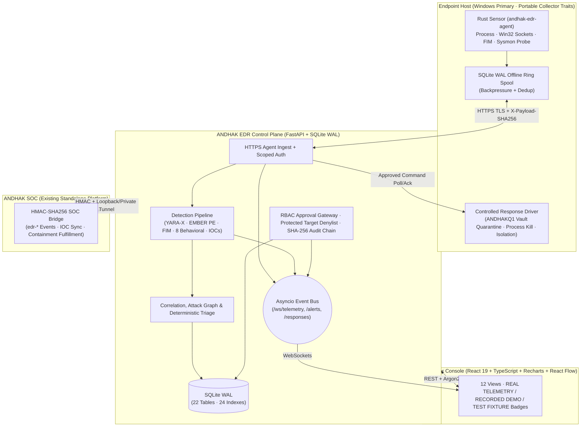

### Key Architectural Guarantees
- **Explicit Telemetry Provenance:** Every UI badge and database record distinguishes `REAL TELEMETRY` (`real_endpoint`), `RECORDED DEMO` (`recorded_demo`), and `TEST FIXTURE` (`test_fixture`).
- **Protected OS Target Denylist:** Hard-blocks (`422 PROTECTED_TARGET_BLOCKED`) terminating kernel PIDs (`<= 4`), `lsass.exe`, `csrss.exe`, `smss.exe`, `wininit.exe`, `services.exe`, `andhak-edr-agent`, quarantining `C:\Windows\System32\*` paths or `..` traversals, or blocking loopback `127.0.0.1` / `localhost`.
- **Two-Step RBAC & Tamper-Evident Audit:** `analyst` proposes -> `responder`/`admin` approves -> agent executes & verifies SHA-256/exit -> append-only `audit_logs` links every step via `entry_hash = sha256(prev_hash + canonical_record)`.
- **Public Read-Only Demo Mode (`ANDHAK_DEMO_MODE=true`):** Serves sanitized `recorded_demo` datasets while blocking all mutations (`403 Forbidden`).

---

## Interactive Console Tour (12 Live Playwright Captures)

All screenshots below were captured cleanly via headless Playwright against a live `uvicorn` FastAPI backend, built Vite frontend (`127.0.0.1:5174`), live compiled Windows `andhak-edr-agent.exe` telemetry, and a seeded recorded attack chain.

### 1. Fleet Posture Overview
Shows real-time host counts, open alerts, correlated incidents, pending containment approvals, Recharts severity/MITRE distributions, and explicit provenance counters (`REAL TELEMETRY` + `RECORDED DEMO`).
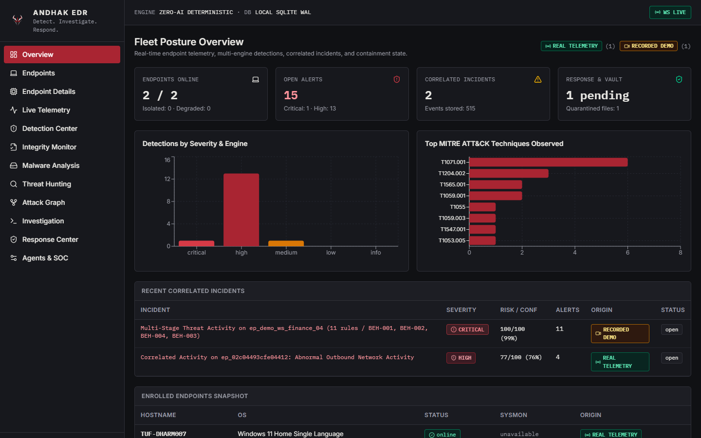

### 2. Endpoint Inventory
Searchable fleet table distinguishing real workstation enrollment (`TUF-DHARM007`, reporting honest `sysmon: unavailable` status when Sysmon is absent) alongside demo endpoints.
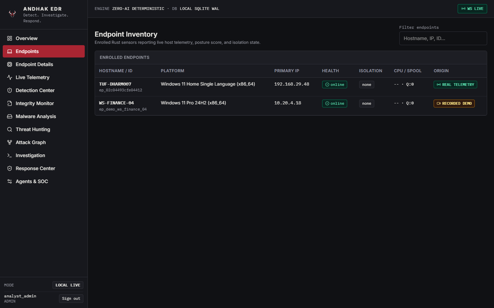

### 3. Endpoint Deep Inspection
Displays host CPU/RAM telemetry, isolation state, and recorded Windows processes (`andhak-edr-agent.exe`, `node.exe`, `cmd.exe`, `brave.exe`) with real `WinVerifyTrust` / `WTD_CHOICE_CATALOG` signature verification.
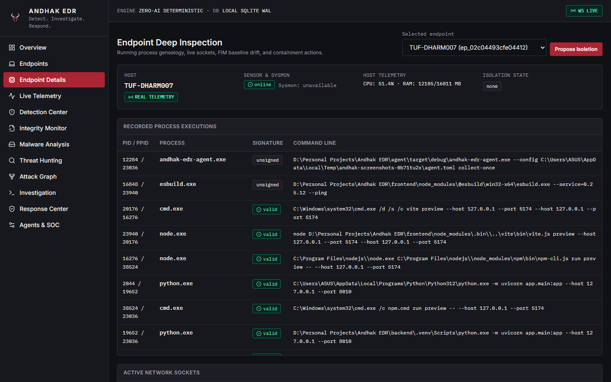

### 4. Live Telemetry Stream
WebSocket-backed `/ws/telemetry` stream with category and data-origin filtering plus pause/resume stream controls.
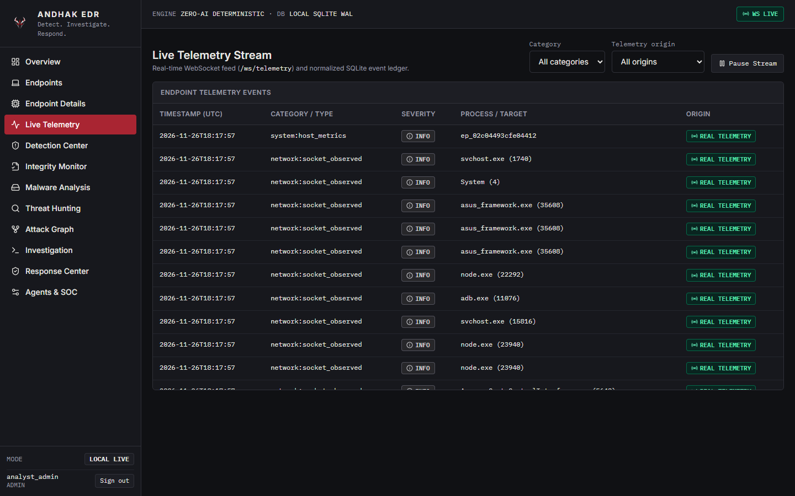

### 5. Detection Center
Multi-engine alert queue keeping `Severity`, `Confidence` (`0–100%`), and `Risk Score` (`0–100`) transparent alongside rule attribution and license provenance (`YARA-X`, `EMBER`, `FIM`, `BEH-001`–`BEH-008`, `IOC`).
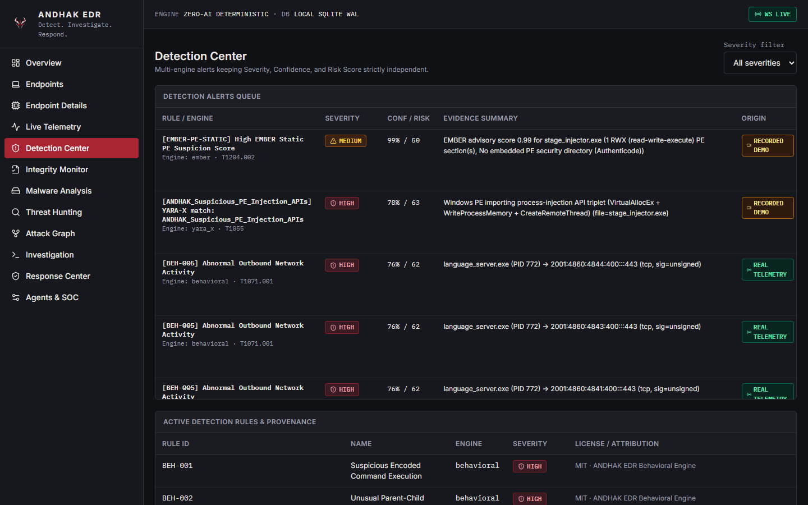

### 6. File Integrity Monitor (FIM)
Directory SHA-256 baseline capture and drift ledger highlighting baseline vs observed SHA-256 digests (`hosts` modification).
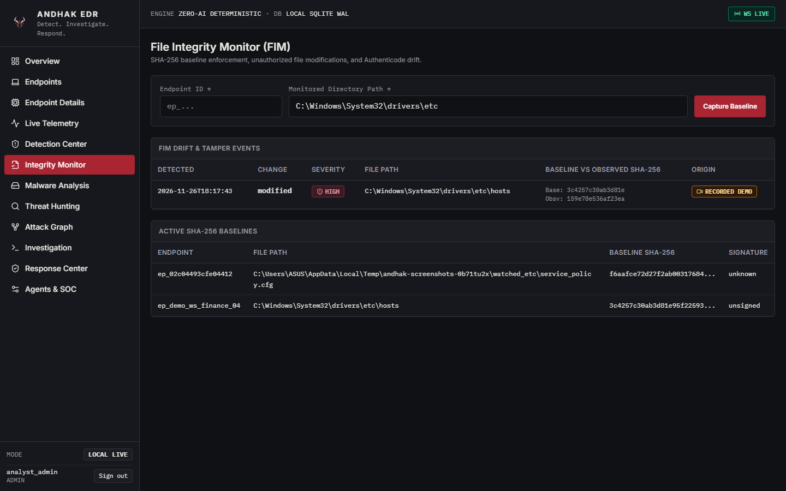

### 7. Malware Analysis & IOC Intel
On-demand static analyzer running in-memory YARA-X rules and EMBER 2381-d PE advisory scoring alongside the local/SOC-synchronized IOC watchlist.
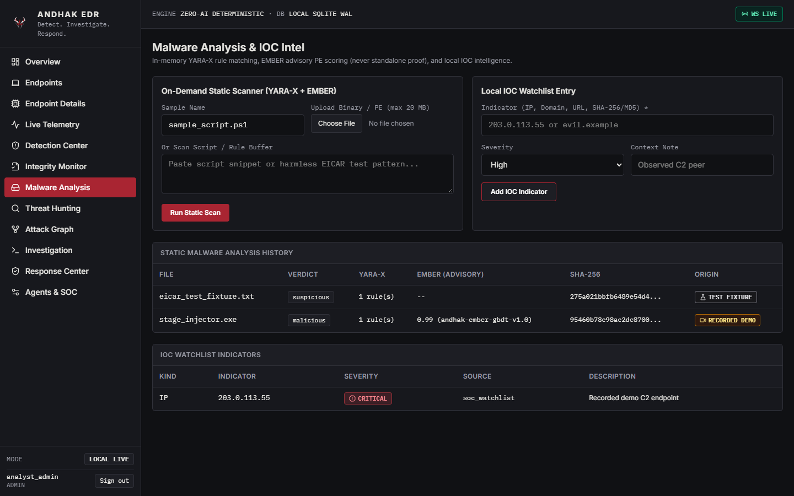

### 8. Threat Hunting Search
Indexed search console filtering historical telemetry across command lines, process names, SHA-256 hashes, remote peers, and origins.
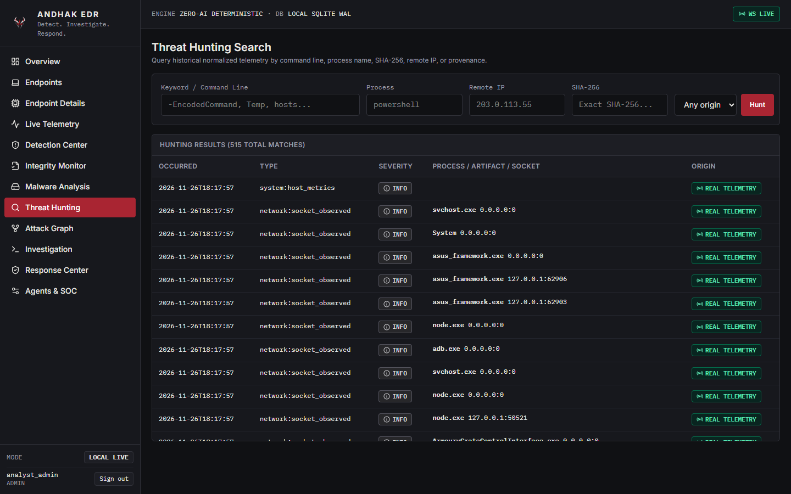

### 9. Interactive Attack Graph (React Flow)
Correlated multi-stage attack provenance linking endpoint -> parent/child process chain (`winword.exe` -> `powershell.exe` -> `updater_stage.exe`) -> outbound socket (`203.0.113.55:4444`) -> touched files -> triggered alerts.
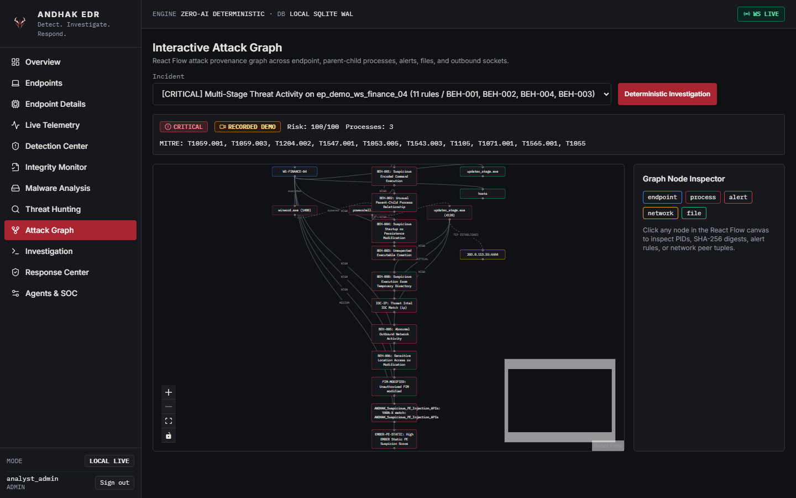

### 10. Deterministic Incident Investigation (Zero-AI)
Produces evidence-cited `deterministic_rules_v1` triage summaries, signature hygiene false-positive checks, approval-gated runbooks, multi-level process trees, ATT&CK evidence mappings, and SHA-256-sealed forensic bundle export.
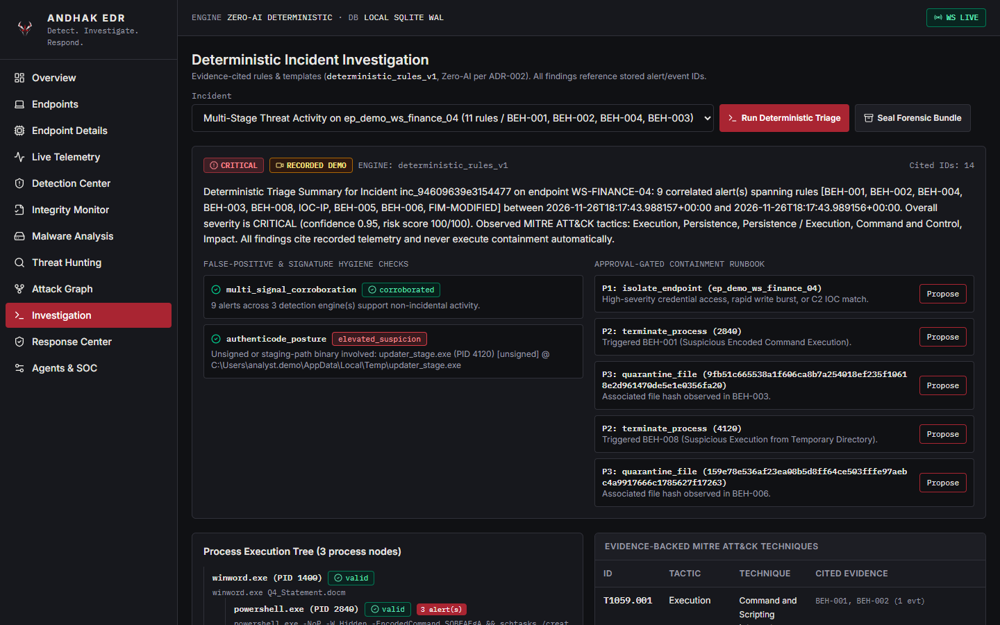

### 11. Agent Provisioning, RBAC & ANDHAK SOC Bridge
Operator Argon2id + JWT authentication, one-time enrollment token provisioning, active policy/retention inspection, and `edr-*` SOC event bridge synchronization.
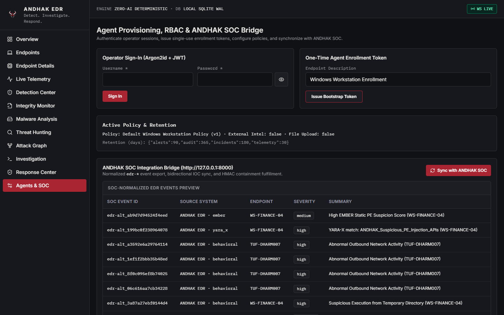

### 12. Response, Quarantine & Audit Center
Two-step response approval queue, `ANDHAKQ1` quarantine vault with SHA-256 verification and reversible rollback controls, plus tamper-evident `AUDIT SHA-256 CHAIN VERIFIED` indicator.
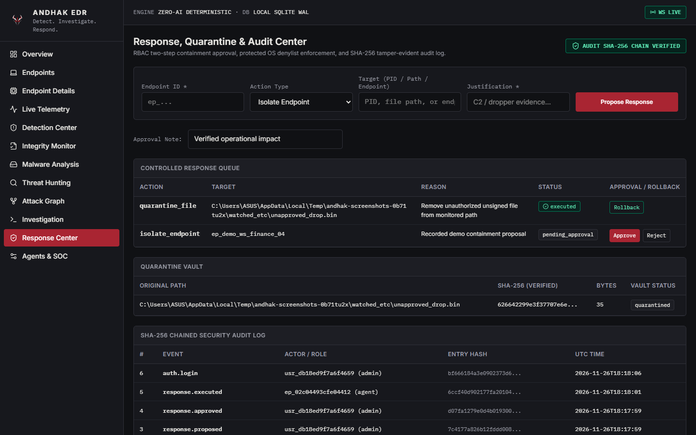

---

## Quick Start (Local Development)

### Prerequisites
- Python `3.12+`
- Rust stable toolchain (`1.85+` / tested on `1.100.0` `x86_64-pc-windows-gnu`)
- Node.js `20+` / `24+` & `npm`

### 1. Start the Backend (Local SQLite WAL)
```powershell
cd backend
python -m venv .venv
.venv\Scripts\python.exe -m pip install -e ".[dev]"
copy ..\.env.example ..\.env  # set a strong ANDHAK_EDR_JWT_SECRET (>=32 chars)
.venv\Scripts\python.exe -m app.cli init-db
.venv\Scripts\python.exe -m app.cli create-user --username admin --role admin --password "ChooseStrongPassword!"
.venv\Scripts\python.exe -m app.cli seed-demo  # optional: seed recorded demo scenario
.venv\Scripts\uvicorn.exe app.main:app --host 127.0.0.1 --port 8010
```

### 2. Start the Frontend Console
```powershell
cd frontend
npm install
npm run dev
# Opens at http://127.0.0.1:5174
```

### 3. Build & Run the Rust Endpoint Sensor
```powershell
cargo build --manifest-path agent/Cargo.toml
# Issue a one-time token from UI (Agents & SOC) or CLI:
backend\.venv\Scripts\python.exe -m app.cli issue-token --description "Workstation"
# Copy agent/config.example.toml -> agent.toml, enroll, and run:
agent\target\debug\andhak-edr-agent.exe --config agent.toml enroll --token "<BOOTSTRAP_TOKEN>"
agent\target\debug\andhak-edr-agent.exe --config agent.toml run
```

### 4. Public Read-Only Demo Mode / Docker Compose
```powershell
$env:ANDHAK_DEMO_MODE = "true"
backend\.venv\Scripts\python.exe -m app.cli seed-demo
backend\.venv\Scripts\uvicorn.exe app.main:app --host 127.0.0.1 --port 8010
```
Or containerized with Docker Compose (`postgres-redis` optional profile included):
```bash
docker compose up --build
# Optional PostgreSQL 16 + Redis 7 profile:
docker compose --profile postgres-redis up --build
```

---

## Repository Structure & Documentation

| Path | Purpose |
| :--- | :--- |
| `agent/` | Rust Tokio endpoint sensor, portable collectors, SQLite WAL spool, response executor (`quarantine_file`, `restore_file`, `terminate_process`, `isolate_endpoint`) |
| `backend/` | FastAPI app, detection engines (`yara-x`, `ember`, `fim`, `behavioral`, `ioc`), forensics, RBAC/safety/audit, WebSockets, ANDHAK SOC bridge |
| `frontend/` | 12-view React 19 + TypeScript + Tailwind CSS + Recharts + React Flow console |
| `docs/ARCHITECTURE.md` | Subsystem architecture, Mermaid diagrams, retention policies, environments |
| `docs/DECISIONS.md` | Architecture Decision Records (`ADR-001`–`ADR-007`) |
| `docs/SECURITY_MODEL.md` | Trust boundaries, STRIDE threat matrix, RBAC & quarantine safety invariants |
| `docs/contracts/` | Canonical SQLite/PG DDL (`DATABASE_SCHEMA.sql`), `API_CONTRACT.md`, `TELEMETRY_SCHEMA.md`, `SOC_INTEGRATION_CONTRACT.md` |
| `docs/DETECTION_ARCHITECTURE.md` | YARA-X, EMBER 2381-d feature extractor, FIM, behavioral rules `BEH-001`–`BEH-008`, scoring |
| `docs/AGENT_SETUP.md` | Windows Rust sensor compilation, configuration, TLS & elevation behavior |
| `docs/PORTFOLIO.md` | Executive engineering summary & testing matrix |
| `docs/DEVELOPMENT_LOG.md` | Persistent stage-by-stage development journal & bug log |
| `docs/KNOWN_LIMITATIONS.md` | Verified environment limits (Sysmon absent, non-admin event log/firewall constraints) |

---

## Verification Matrix

| Suite | Command | Outcome |
| :--- | :--- | :--- |
| Rust Sensor (`fmt`, `clippy`, unit tests) | `cargo test --manifest-path agent/Cargo.toml` | `10 passed; 0 failed` |
| Backend Lint & Formatting | `ruff check backend/app backend/tests` | Passed (`0` errors) |
| Backend API, Detection, Forensics, Response, WS, SOC & Live Compiled-Agent E2E | `pytest backend/tests -v` | `14 passed; 0 failed` (`36.72s`) |
| Frontend Build & UI Tests | `cd frontend && npm run build && npm test` | Passed (`3/3` Vitest) |

---

## Known Limitations
- **Sysmon Absence on Host:** When `Microsoft-Windows-Sysmon/Operational` is not installed, `andhak-edr-agent` reports `sysmon: unavailable` honestly rather than fabricating Sysmon events.
- **Unprivileged Sensor Operation:** Without elevated Administrator/`SYSTEM` privileges, certain protected Windows process executable paths (`SYSTEM` processes) are inaccessible (`partial` mode), and Windows Firewall isolation records exact planned `netsh advfirewall` rules under `dry_run_unprivileged` unless elevated.
- **Zero-AI Policy & Standalone IdP:** Generative AI/LLM analysts are intentionally omitted per owner directive (`ADR-002`); `revoke_session` over the SOC bridge returns HTTP `501` (`no identity connector`) when no external IdP is configured.

---

## License

MIT License — Copyright (c) 2026 Dharm Patel (`DDharm007`). YARA-X BSD-3-Clause attribution preserved in `THIRD_PARTY_LICENSES/YARA-X-BSD-3-Clause.txt`.
