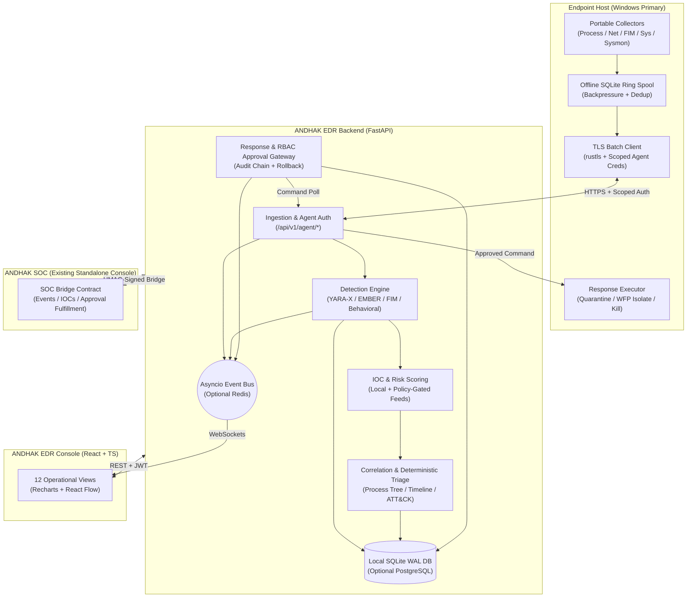
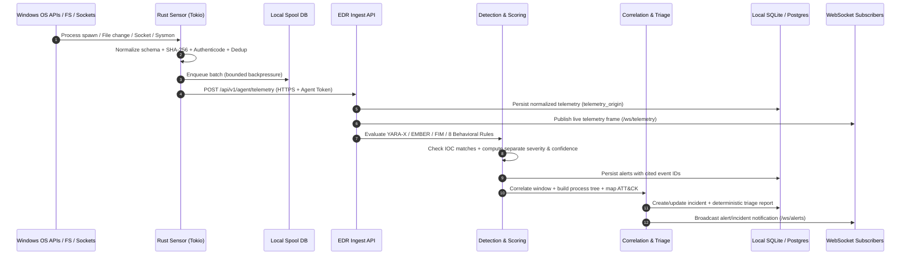
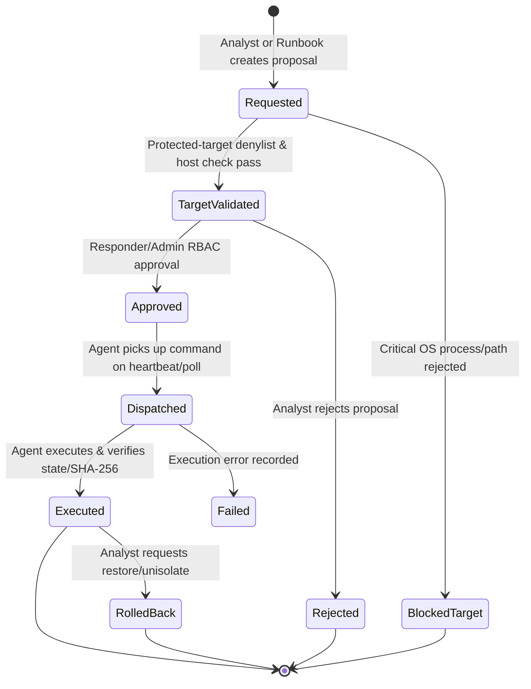
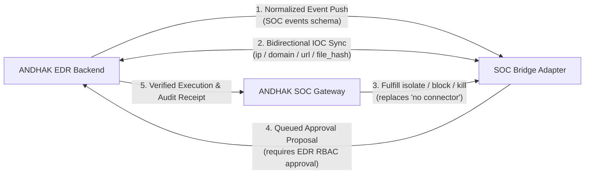

# ANDHAK EDR — System Architecture

**Product:** ANDHAK EDR (`Detect. Investigate. Respond.`)  
**Companion Platform:** [ANDHAK SOC](https://github.com/DDharm007/Andhak-SOC)  
**Operating Paradigm:** Local-first SQLite database (with optional PostgreSQL/Redis scaling adapters) and **100% deterministic, zero-AI** detection, correlation, investigation, and controlled response engineering.

---

## 1. Architectural Scope & Separation of Concerns

ANDHAK EDR is organized into six strictly decoupled subsystems (`A`–`F`), keeping the Rust sensor, Python detection/response control plane, React operator console, and ANDHAK SOC integration bridge cleanly separated by typed contracts.

### A. Endpoint Sensor (`agent/` — Rust + Tokio)
- **Responsibility:** Low-overhead endpoint telemetry acquisition, offline buffering, TLS batch delivery, and authorized containment execution.
- **Portable Collector Traits:** Abstract interfaces (`ProcessCollector`, `NetworkCollector`, `FilesystemCollector`, `SystemCollector`, `EventLogCollector`, `ResponseDriver`) isolate OS-specific calls behind `platform::windows` (primary) so `platform::linux` and `platform::macos` can be added without modifying sensor core logic.
- **Lifecycle:**
  1. **Bootstrap & Enrollment:** Registers with Management Backend using an operator-issued one-time enrollment token (`POST /api/v1/agent/enroll`), receiving an endpoint UUID and a scoped per-agent bearer/HMAC credential stored outside the binary.
  2. **Steady-State Telemetry:** Streams normalized process creation/ancestry, SHA-256 file hashes, WinVerifyTrust digital signatures, TCP/UDP socket-to-PID mappings, configured filesystem watch events (with exclusions and deduplication), host CPU/RAM/disk metrics, and Sysmon channel events (reporting `unavailable` when Sysmon is not installed).
  3. **Heartbeat & Policy Sync:** Sends periodic health heartbeats (`POST /api/v1/agent/heartbeat`) carrying agent CPU/RSS memory, queue depth, sensor readiness flags, and policy version; pulls policy updates and pending response commands.
  4. **Backpressure & Offline Spooling:** Bounds in-memory channels; overflows to an encrypted/WAL-mode local SQLite ring buffer (`agent-spool.sqlite3`) with exponential backoff + jitter and content-hash deduplication.
  5. **Graceful Shutdown:** Flushes pending batches on `CTRL_C` / service stop signals before closing transport handles.

### B. Detection Engine (`backend/app/detection/`)
- **YARA-X File & Memory-Buffer Scanner:** Evaluates compiled YARA-X rules (`yara-x >= 1.24`), retaining explicit rule provenance, license attribution, matched string offsets, and deterministic rule metadata.
- **Static PE Classification (EMBER Pipeline):** Extracts structural Windows PE features (`pefile` byte histograms, byte-entropy histograms, section entropy, import/export tables, header characteristics) and evaluates a versioned non-generative LightGBM / scikit-learn classifier with explicit dataset provenance and calibrated probability score. Scores are never treated as standalone proof of malware.
- **File Integrity Monitoring (FIM):** Manages policy-driven directory baselines (`SHA-256`, byte length, modification timestamp, Authenticode verification), detects unauthorized creation/modification/deletion/renaming, and distinguishes signed updates from unsigned tampering.
- **Behavioral Detection Engine:** Stateful sliding-window evaluator operating over normalized process, file, registry/startup, and socket streams for eight core scenarios:
  1. Suspicious encoded command execution (`powershell -enc`, obfuscated `cmd`/`wscript`)
  2. Unusual parent-child process relationships (e.g., Office/browser spawning shell/scripting host)
  3. Unexpected executable creation in user-writable/system-adjacent paths
  4. Suspicious startup/Run-key or scheduled-task/service persistence modifications
  5. Abnormal outbound network activity (rare ports, unverified executables opening external sockets, IOC matches)
  6. Unexpected access or modification inside monitored sensitive directories
  7. Rapid file modification / rename bursts (ransomware-like behavioral velocity)
  8. Execution from temporary or staging directories (`%TEMP%`, `AppData\Local\Temp`, `Downloads`, `ProgramData`)
- **Transparent Risk Scoring:** Keeps `severity` (`critical | high | medium | low | info`) and `confidence` (`0.0–1.0`) strictly independent alongside computed `risk_score` (`0–100`), matched rule ID, cited raw event IDs, and deterministic next steps.

### C. Intelligence & Deterministic Investigation Engine (`backend/app/intelligence/` & `backend/app/forensics/`)
> **Architectural Note (No-AI Directive):** Per explicit project requirement, ANDHAK EDR contains **no generative AI or LLM runtime** (no cloud APIs, no local LLM sidecar). All incident interpretation, narrative generation, ATT&CK mapping, false-positive assessment, and remediation guidance are produced by deterministic, evidence-cited rules and templates.
- **IOC Enrichment:** Local IOC watchlist (`ip`, `domain`, `url`, `file_hash`) synchronized with ANDHAK SOC, plus strictly policy-gated external enrichment (MalwareBazaar, AbuseIPDB, optional VirusTotal) restricted to hash/IP/domain lookups when explicitly enabled (`ANDHAK_INTEL_EXTERNAL_ENABLED=true`). Private file bytes are never uploaded externally (`ANDHAK_INTEL_ALLOW_FILE_UPLOAD=false`).
- **Event Correlation & Incident Grouping:** Aggregates alerts within configurable time windows by `endpoint_id`, `process_guid` / ancestry root, shared IOC, or MITRE tactic chain, suppressing alert storms via deduplication keys.
- **Process Tree & Attack Timeline:** Reconstructs multi-level parent-child process trees annotated with SHA-256 hashes, signers, files touched, sockets opened, and detections triggered, ordered on a chronological UTC timeline.
- **MITRE ATT&CK Mapping:** Maps verified detection triggers strictly to observed tactics, techniques, and sub-techniques with explicit supporting event IDs; unsupported techniques are never guessed.
- **Deterministic Forensic Bundler & Triage Engine:** Collects immutable evidence bundles (process metadata, hashes, network tuples, detection evidence, timeline, SHA-256 bundle manifest) and generates deterministic incident summaries, threat-pattern hypotheses (e.g., staged dropper vs persistence chain), rule-based false-positive checks (e.g., valid Microsoft/vendor signature, known updater path), and ranked containment runbooks.

### D. Response Engine (`backend/app/response/`)
- **Controlled Enforcement Capabilities:** Endpoint network isolation (Windows Firewall/WFP rules scoped to allow management backend IP/port), process termination, file quarantine (SHA-256 pre/post verification, locked vault storage, authorized restoration), and policy enforcement.
- **Safety & Governance Controls:**
  - Two-step workflow: `request -> RBAC verify -> analyst approve/reject -> agent dispatch -> execute -> verify -> optional rollback`.
  - Immutable **Protected Target Denylist** prevents killing critical Windows processes (`System`, `smss.exe`, `csrss.exe`, `wininit.exe`, `services.exe`, `lsass.exe`, `svchost.exe` core, or the `andhak-edr-agent` PID/binary) and prevents quarantining protected OS directories (`C:\Windows\System32` system binaries).
  - Append-only SHA-256 hash-chained `audit_logs` capturing analyst identity, endpoint identity, action, approval note, verification evidence, and rollback outcome.

### E. Management Backend (`backend/app/main.py`)
- **Framework:** Python 3.12 + FastAPI + Pydantic v2 + SQLAlchemy 2.x.
- **Local-First Storage:** Primary local **SQLite** database (`WAL` mode, foreign keys enabled, `.local-data/andhak-edr.sqlite3` or `%LOCALAPPDATA%\AndhakEDR\andhak-edr.sqlite3`) requiring zero external servers. Configuration supports swapping `ANDHAK_EDR_DB_URL` to PostgreSQL (`postgresql+asyncpg://...`) without schema rewrites.
- **Real-Time Event Bus:** Built-in in-process `asyncio` fan-out broker powering WebSocket endpoints (`/ws/telemetry`, `/ws/alerts`, `/ws/responses`), with an optional Redis pub/sub adapter when `ANDHAK_EDR_REDIS_URL` is configured.
- **Auth & RBAC:** JWT analyst sessions (`admin`, `responder`, `analyst`, `readonly_demo`) + separate per-endpoint agent credential authentication + authenticated HMAC bridge for ANDHAK SOC.

### F. Frontend (`frontend/` — React + TypeScript + Vite + Tailwind CSS)
- **Visual System:** Inherits ANDHAK SOC's terminal-inspired visual grammar and official [andhak-logo.png](file:///D:/Personal%20Projects/Andhak%20SOC/frontend/public/andhak-logo.png), rendered with the EDR palette (`#101114` primary, `#17181D` secondary, `#1D1E24` elevated, `#303139` border, `#A92532` primary red, `#D63A46` critical red, `#E8E7E3` text, `#898A92` muted) and `IBM Plex Mono` / `JetBrains Mono` + `Inter`.
- **12 Dedicated Views:** Overview, Endpoint Inventory, Endpoint Details, Live Telemetry, Detection Center, Integrity Monitor, Malware Analysis, Threat Hunting, Attack Graph (React Flow), Response Center, Deterministic Incident Investigation, and Agent Management.
- **Telemetry Provenance Clarity:** Every table, chart, and incident banner explicitly badges `REAL TELEMETRY`, `RECORDED DEMO`, or `TEST FIXTURE`.

---

## 2. Architecture & Data-Flow Diagrams

### Overall System Architecture

### Endpoint Telemetry & Detection Data Flow

### Incident Response Lifecycle

### ANDHAK SOC Integration Flow

---

## 3. Storage & Retention Policies

| Data Domain | Primary Local Storage | Optional Production Target | Default Retention | Pruning Rule |
| :--- | :--- | :--- | :--- | :--- |
| **Telemetry Events & Sockets** | SQLite `WAL` (`telemetry_events`, `network_sockets`, `process_executions`) | PostgreSQL 16+ partitioned by day/month | **30 days** (`ANDHAK_RETENTION_TELEMETRY_DAYS`) | Scheduled background prune deletes unreferenced events older than 30 days; events cited by open/saved incidents are retained until incident archival. |
| **Detection Alerts & Malware Scans** | SQLite (`alerts`, `malware_analyses`, `fim_events`) | PostgreSQL 16+ | **90 days** (`ANDHAK_RETENTION_ALERTS_DAYS`) | Pruned after 90 days unless linked to an active or archived incident. |
| **Incidents & Forensic Bundles** | SQLite (`incidents`, `forensic_bundles`, `deterministic_investigations`) | PostgreSQL 16+ | **180 days** (`ANDHAK_RETENTION_INCIDENTS_DAYS`) | Closed incidents retained 180 days; evidence hashes retained for compliance lookup. |
| **Response & Security Audit Log** | SQLite (`audit_logs`, `response_actions`) | PostgreSQL 16+ | **365 days** (`ANDHAK_RETENTION_AUDIT_DAYS`) | Append-only SHA-256 hash chain; never truncated automatically below retention floor. |
| **Agent Offline Spool** | SQLite (`agent-spool.sqlite3`) on endpoint | Same (local endpoint disk) | **Max 256 MB / 72 h** | FIFO eviction of lowest-severity informational events if offline backlog hits cap; critical alerts prioritized. |

---

## 4. Development & Deployment Environments

| Environment | Purpose | Database & Bus | Auth & Binding | Notes |
| :--- | :--- | :--- | :--- | :--- |
| **Local Windows Dev** | Primary engineering & endpoint testing on Windows 11 | Local SQLite (`WAL`, `.local-data/andhak-edr.sqlite3`) + in-process `asyncio` bus | `127.0.0.1:8010` API + `127.0.0.1:5174` Vite UI; JWT + scoped agent auth active | Zero external DB/Docker install required. |
| **Containerized / Production Profile** | Multi-endpoint deployment & CI integration | PostgreSQL 16+ (`asyncpg`) + Redis 7+ pub/sub via `docker-compose.yml` | HTTPS/TLS termination, strict CORS, RBAC mandatory | Identical SQLAlchemy models & Alembic migrations. |
| **Public Read-Only Demo** | Portfolio & browser exploration without agent install | Isolated read-only SQLite snapshot (`telemetry_origin = recorded_demo`) | `ANDHAK_DEMO_MODE=true`; all mutation & response endpoints hard-return `403` | Replays genuine captured test-session telemetry, clearly labeled `RECORDED DEMO`. |
